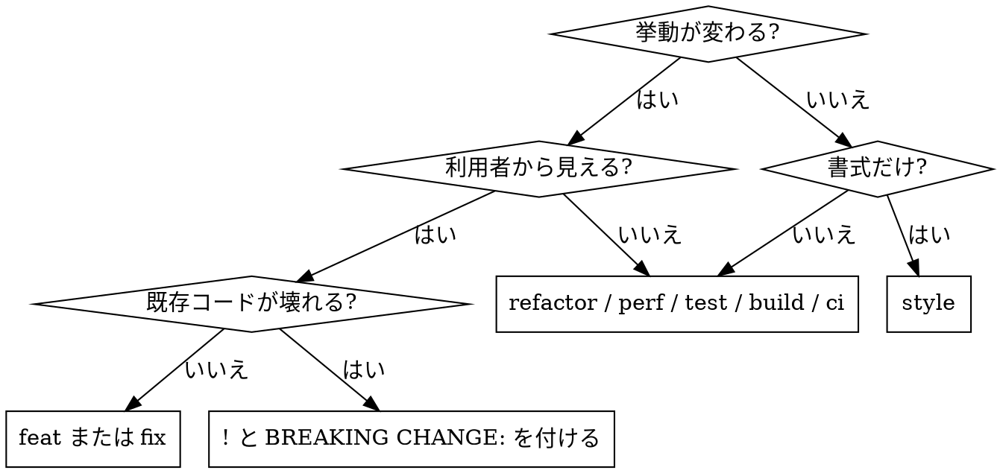

# Conventional Commits でコミットメッセージを書く

## 概要

ステージされた変更を読み、Conventional Commits 形式のコミットメッセージを組み立てて提示する。

**このスキルはメッセージを作るところまでを担う。`git commit` は実行しない。**
コミットするかどうかは、メッセージを見た人間が決める。

## 使う場面

- `git commit` を実行しようとしている
- コミットメッセージを考える、書き直す、`--amend` で差し替える
- 「コミットメッセージを作って」と頼まれた

使わない場面: コミット済み履歴の分析、リリースノートの生成、ブランチ名の命名。
PR の説明文とタイトルは `writing-pull-requests` を使う。

## 手順

### 1. 変更を読む

```bash
git status --short
git diff --staged
```

**diff を読まずにメッセージを書いてはいけない。** ファイル名やパスからの推測は禁止。
diff が巨大で全部読めない場合は `git diff --staged --stat` で当たりをつけ、主要な変更ファイルの diff を読む。読めなかった範囲があるなら、その事実をメッセージと一緒に伝える。

ステージされた変更が空なら、そこで止めて「ステージされた変更がない」と伝える。**勝手に `git add` しない。**

### 2. type を決める

| type | 使う場面 | 迷いやすい境界 |
|---|---|---|
| `feat` | 利用者から見える機能の追加 | 内部関数を足しただけなら `feat` ではない |
| `fix` | バグ修正 | 意図した挙動に戻すのが `fix`。仕様変更は `feat` |
| `docs` | ドキュメントのみ | コード内コメントだけの変更もここ |
| `style` | 書式のみ（整形、空白、セミコロン） | 挙動が1ミリも変わらない場合に限る |
| `refactor` | 挙動を変えない内部構造の整理 | 速度が目的なら `perf` |
| `perf` | 性能改善 | |
| `test` | テストの追加・修正 | テストのために本体も直したなら本体側の type を使う |
| `build` | ビルド設定、依存関係の更新 | |
| `ci` | CI設定 | |
| `chore` | 上記に当てはまらない雑務 | **迷ったときの逃げ道に使わない**。まず上の表を見直す |
| `revert` | 差し戻し | 本文に `This reverts commit <sha>` を書く |

### 3. 形式を組む

```
<type>(<scope>)!: <説明>

<本文>

<フッター>
```

- **scope**: 任意。変更が特定の領域に収まっているときだけ付ける。英小文字（例: `auth`, `api`, `deps`）。領域をまたぐ変更では省く
- **説明**: **日本語**。常体または体言止め、句点なし、50文字を目安に収める
- **本文**: diff から理由が読み取れないときだけ書く。**何をしたか（What）ではなく、なぜそうしたか（Why）**を書く。1行72文字を目安に折り返す
- **`!` と `BREAKING CHANGE:`**: 既存の利用者のコードが壊れる変更のみ。両方付ける
- **フッター**: `Refs: #123` / `Closes: #123`

### 4. 既存の履歴に合わせる

```bash
git log --oneline -20
```

そのリポジトリで実際に使われている type と scope の書き方に合わせる。
このスキルの表と履歴が食い違う場合は、**履歴を優先する**。

### 5. 提示する

メッセージを ``` で囲んで示し、そのまま使えるコマンドを添える。

## 例

```
feat(auth): リフレッシュトークンの自動更新に対応

アクセストークンの有効期限が15分と短く、長時間の操作中に
セッションが切れる報告があったため。

Refs: #421
```

```
fix(api): 空配列を渡したときの500エラーを解消
```

```
refactor: バリデーションを validators/ 配下に切り出し
```

## よくある失敗

| 失敗 | どうするか |
|---|---|
| 「各種修正」「いろいろ更新」「WIP」 | 中身のない説明は書かない。diff を読めば必ず具体名が出る |
| 迷ったら全部 `chore` | type の表の境界列を読み直す。それでも決まらないなら候補を2つ挙げて聞く |
| diff を読まずファイル名から推測 | `git diff --staged` を読む。例外なし |
| 無関係な変更を1つのメッセージに丸める | 下の「変更が混在しているとき」に従う |
| `git add` してからメッセージを作る | ステージ内容は変えない。空なら空と伝える |
| 本文に diff の要約を書き並べる | 本文は Why のみ。What は diff を見れば分かる |
| 説明が長すぎて1行に収まらない | 説明を50文字に削り、詳細は本文へ移す |
| 説明を英語で書く | 日本語で書く。type と scope だけ英語 |

## 変更が混在しているとき

ステージされた変更に無関係な目的が2つ以上含まれている場合、**1つのメッセージに無理やり詰め込まない。**

1. 目的ごとに変更をグループ分けして示す
2. グループごとのメッセージ案を出す
3. 分割するための `git reset` / `git add` 手順を添える

分割せず1コミットにしたいと言われたら、その判断に従って最も比重の大きい目的を type に選び、残りを本文に列挙する。

## 判断が要る分岐


